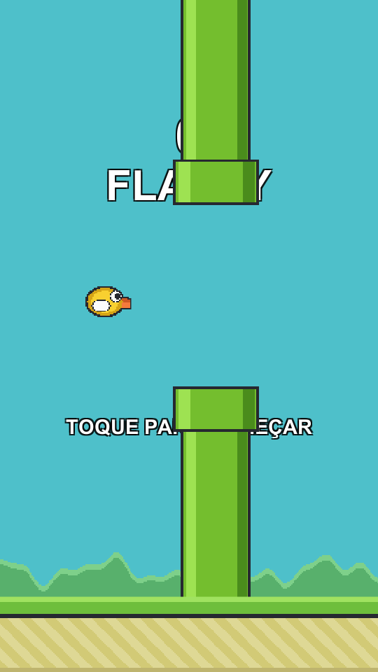

# Flappy Plane

A side-scrolling plane game for Android, built with **Unity 6 and C#**. It started as a Flappy Bird clone and turned into something else: instead of discrete taps, the control is **continuous**.



**How to play:** keep your finger on the screen to keep the engine running, and slide up and down to choose your altitude. Lift your finger and the engine cuts out, so the plane falls. Fly between the buildings and the storm clouds.

- **Unity:** 6000.1.12f1
- **Target platform:** Android (portrait, ARM64, IL2CPP)
- **Package:** `com.srnando.flappyclone`
- **Highlights:** continuous touch control, speed that ramps up with your score, four random crash animations, a "hit-stop" freeze-frame on impact, random bird strikes and a clothesline gag, rotating game-over quips, an AdMob banner behind a swappable ads layer, and tuning via a single `ScriptableObject`.

## Getting started

1. Unity Hub → **Add** → select the `flappy-plane` folder.
2. Open the project and the scene `Assets/Scenes/Game.unity`.
3. Press Play. In the Editor, hold the mouse button and move the cursor up and down (the space bar also turns the engine on, but without steering).

## The "Flappy" menu (in the Editor)

Everything in this project is generated by script. Nothing was assembled by hand. If something goes missing or you want to start over, use the **Flappy** menu in the Editor's menu bar:

| Menu item (as shown in the Editor)                 | What it does                                                                                                                         |
| -------------------------------------------------- | ------------------------------------------------------------------------------------------------------------------------------------ |
| `0 - Gerar tudo (arte + som + cena + Android)`     | Generate everything: runs all the steps below in sequence                                                                            |
| `1 - Gerar arte placeholder`                       | Generate placeholder art: recreates the PNGs in `Assets/Art` (does not touch hand-made art)                                          |
| `1b - Gerar sons placeholder`                      | Generate placeholder sounds: synthesizes any missing WAVs in `Assets/Audio`, never overwriting existing ones                         |
| `1c - Ajustar importação da arte manual`           | Fix hand-made art import: resets pivot, PPU and filter for `lightning.png`, `cloud.png`, `plane.png`, the plane parts, the buildings and the shop's `A320.png` |
| `1d - Repor nuvem placeholder`                     | Reset the placeholder cloud band (code-generated)                                                                                    |
| `1e - Repor avião placeholder`                     | Reset the placeholder plane (code-generated)                                                                                         |
| `1g - Repor pombo placeholder`                     | Reset the placeholder pigeon: restores the two code-generated frames                                                                 |
| `1f - Repor sons placeholder`                      | Reset the placeholder sounds: restores the six synthesized sounds, overwriting whatever is there                                     |
| `2 - Montar cena do jogo`                          | Build the game scene: recreates `Assets/Scenes/Game.unity` and the obstacle prefab                                                   |
| `3 - Configurar Android`                           | Configure Android: applies the Android Player Settings                                                                               |
| `4 - Gerar APK`                                    | Build the APK: `Builds/Android/FlappyClone.apk`                                                                                      |
| `9 - Salvar preview PNG`                           | Save preview PNG: renders the scene to `preview.png` in the project root                                                             |

> `2 - Montar cena do jogo` **overwrites** the scene. If you edit the scene by hand, don't run it again.

> The menu labels are in Portuguese because that is how they appear in the Editor; the second column gives the English meaning. Elsewhere in this README they are referred to by their number (`Flappy → 1c`, `Flappy → 2`...).

## Project structure

```
Assets/
├─ Art/                  Generated PNGs (replace with final art whenever you like)
├─ Audio/                Generated WAVs (replace with real sounds whenever you like)
├─ Editor/               Generation scripts, not included in the build
│  ├─ Bootstrap.cs       Entry point (also used from the command line)
│  ├─ PlaceholderArt.cs  Draws the sprites pixel by pixel
│  ├─ PlaceholderAudio.cs Synthesizes the sound effects in code
│  ├─ SceneBuilder.cs    Builds the scene and the pipe/obstacle prefab
│  ├─ AndroidSetup.cs    Android Player Settings
│  └─ BuildScript.cs     APK build
├─ Prefabs/ObstaclePair.prefab
├─ Scenes/Game.unity
├─ Settings/GameConfig.asset   ← every balancing number
└─ Scripts/
   ├─ GameConfig.cs        ScriptableObject: engine response, gravity, gap...
   ├─ GameManager.cs       State (Ready/Playing/GameOver), score, best score
   ├─ Airplane.cs          Engine on/off, chasing the finger's height
   ├─ EngineSmoke.cs       Smoke trail from the exhaust while flying
   ├─ ObstacleSpawner.cs   Spawns building + lightning pairs at the configured interval
   ├─ ObstaclePair.cs      Movement and despawn of each pair
   ├─ PigeonSpawner.cs     Decides when a pair brings a pigeon and releases it
   ├─ Pigeon.cs            The pigeon: flies, gets dizzy on impact and flees
   ├─ ScoreZone.cs         +1 point trigger in the gap
   ├─ ScrollingTiles.cs    Endless clouds, bushes and ground (with parallax)
   ├─ UIController.cs      Score, best score in the corner, start / end screens
   ├─ GameInput.cs         Held touch, finger position, mouse and keyboard
   ├─ Ads/                 Ads layer (see the section below)
   ├─ AudioManager.cs      Short effects and the engine loop
   ├─ CrashEffects.cs      Picks and plays the crash animations
   ├─ FxParticle.cs        Disposable particle (spark, smoke, debris, ring)
   ├─ CameraShake.cs       Camera shake
   └─ ScreenFlash.cs       Full-screen flash
```

The obstacle sprites use **custom pivots**: the building's pivot is on its roof and it grows downward, while the lightning's pivot is at its tip and it grows upward. That is what lets both sit flush against the edges of the gap without mirroring anything. If you replace the art, keep the pivots.

The bottom obstacles are the `predio *_Prancheta 1.png` buildings in `Assets/Art` (`predio` is Portuguese for "building"). They are used in alphabetical order and cycle: building 1, building 2, building 3, building 1... The list comes from the folder, so exporting a fourth building (`predio 4_Prancheta 1.png`) and running `1c` + `2` is enough to get it into the game. `1c` equalizes the **wall width** of all of them (not the image width, which includes the roof and antenna), and each obstacle stretches the building as much as needed to reach the ground, never shrinking it.

`lightning.png` and `cloud.png` are **hand-drawn** files (Illustrator, Bilinear filter). `1 - Gerar arte placeholder` never touches them; their import settings are set by `Flappy → 1c`. The lightning is 225×797 at 200 PPU. The sprite is short on purpose: `ObstaclePair` stretches it vertically for each obstacle to cover from the gap to beyond the screen, which gives every bolt a different length for free.

The lightning's collider is a **polygon** generated from its own shape, not a rectangle: with a rectangle the plane died in empty air next to the zigzag.

## The sky

`#24606E`, a rainy-day blue. It is the camera's background colour (there is no sprite acting as the sky) and lives in `SceneBuilder`'s `BuildCamera`.

It came from the original `#4EC0CA` in a single move: **the same hue and the same saturation, at half the brightness** (185° → 191°, 53% → 51%, lightness 55% → 29%). Darkening without touching the hue is what keeps the game recognisable: it looks like the same sky on a bad day, not a game with a different palette.

With the darker sky, the lightning's yellow and the plane's red gained contrast, and the `#1D1D1B` outline on the underside of the cloud band still separates it from the sky. The ground and bushes were left alone on purpose: with everything dark the screen felt closed in, and the green strip at the bottom is what still lets light into the scene.

## The cloud band

The top of the screen has a band of storm clouds that scrolls on its own at **half** the ground speed, using the same `ScrollingTiles` as the bushes with a different multiplier. The lightning bolts are born from inside it: the band draws at order 8, in front of the lightning (5) and behind the plane (20), so the top end of the bolt is hidden in the cloud instead of ending in mid-air. `lightningTopY` in `GameConfig` controls how far up into the band the bolt goes.

The band is paint only: it has no collider. Its top is pinned at `y = 5.4` (`CloudTopY` in `SceneBuilder`), slightly above the screen edge, and its height comes from the sprite itself, so drawing a thicker band needs no code.

### Redrawing the band (Illustrator)

| Item      | Value                                                                    |
| --------- | ------------------------------------------------------------------------ |
| Artboard  | **1344 × 352 px**, RGB, transparent background                           |
| In world  | 6.72 × 1.76 units (200 PPU), the width of one ground tile                |
| File      | `Assets/Art/cloud.png`, PNG-24 with alpha                                |
| Pivot     | centre (set by `1c`)                                                     |

The **width is the only sacred measurement**: `1c` computes the PPU from it so the tile is always 6.72 units wide, so you can draw at 672, 1344 or 2048 px wide. That changes sharpness, not in-game size. The height is free: the band grows downward from `y = 5.4`.

Three horizontal lines govern the composition (measured from the top of the 352 px artboard):

- **0 px, the top.** Must be painted across the full width, with no outline: this edge is cut off by the screen and never seen.
- **80 px, the top of the screen** (`y = 5`). Only from here down does the player see anything. This is where the drawing has to start to matter.
- **280 px, the safety line** (`y = 4`). No painted pixel should go past it. The highest gap has its top at `y = 3.4`, and the player must never be in doubt about what is paint and what kills.

**Looping seam.** Two tiles rotate in a loop, so the right edge must continue into the left. In Illustrator: draw beyond the artboard, select everything and use `Object → Transform → Move` with _Horizontal_ `1344 px`, _Vertical_ `0` and the **Copy** button, then the same with `-1344 px`. Every shape that leaves one side now has a twin entering from the other. On export, turn on **Use Artboards**, which crops the rest.

**Style.** The sky is `#24606E` and the lightning is `#FFD642` with a `#1D1D1B` outline. The cloud has to be dark enough for the yellow to pop: something between `#9CA4C0` on the lit top and `#525A78` on the underside works. Use the same `#1D1D1B` as the lightning for the bottom outline, about 8 px thick at 200 PPU, so the family matches. Avoid near-whites: the score is white text and falls right on top of the band.

**Helpful details.** An underside scalloped into bubbles of different sizes is what makes the lightning look like it comes from a specific place. Don't draw lightning in the band: those are born in `ObstaclePair` at a random `x`. No drop shadow below the safety line.

After replacing the file: `Flappy → 1c` (import) and `Flappy → 2` (the scene stores the band's position, which depends on the drawing's height). To get the code-generated band back, use `Flappy → 1d`.

## Balancing

Select `Assets/Settings/GameConfig.asset` in the Inspector. The fields that change difficulty the most:

| Field                  | Default | Effect                                                     |
| ---------------------- | ------- | ---------------------------------------------------------- |
| `obstacleGap`          | 2.8     | Size of the gap between the tower and the cloud            |
| `obstacleSpeed`        | 3.2     | **Initial** scroll speed                                   |
| `speedPerPoint`        | 0.06    | How much the speed rises per point                         |
| `maxObstacleSpeed`     | 6.5     | Speed cap (reached at around 55 points)                    |
| `speedRamp`            | 0.6     | Smoothness of the acceleration at each point               |
| `spawnSpacing`         | 4.3     | Distance between pairs, in units                           |
| `followSpeed`          | 7.5     | Maximum vertical speed with the engine on                  |
| `followResponsiveness` | 7       | How glued to the finger the plane stays                    |
| `followAccel`          | 60      | How sharp the response is when changing direction          |
| `gravityScale`         | 3.2     | Weight of the fall with the engine off                     |

Changes apply immediately, with no recompiling.

### How progression works

`GameManager.CurrentSpeed` is the single source of speed: obstacles, ground and bushes all read from it. The target is `obstacleSpeed + score × speedPerPoint`, capped by `maxObstacleSpeed`, and the actual speed chases that target at `speedRamp` units per second, so each point doesn't cause a jolt.

Spawning is by **distance**, not time: the interval is `spawnSpacing ÷ CurrentSpeed`. Without that, speeding up would spread the pairs apart and cancel much of the difficulty increase.

## Sound

The sound effects are **synthesized in code** in `PlaceholderAudio.cs` and saved as 16-bit mono WAV at 44.1 kHz, except where noted. Nothing comes from outside.

| File                  | When it plays                  | How it's made                                                                       |
| --------------------- | ------------------------------ | ----------------------------------------------------------------------------------- |
| `sfx_start.wav`       | When the run starts            | Sawtooth sweeping 70→150 Hz with a breath of noise                                  |
| `sfx_score.wav`       | On every point                 | Two square-wave beeps, 880 Hz and 1318 Hz                                           |
| `crash.mp3`           | On impact (building or ground) | White noise over a bass falling from 200 to 32 Hz                                   |
| `Relampago_sound.wav` | On impact with the lightning   | Separate file, not synthesized                                                      |
| `sfx_record.wav`      | On a new best score            | Four-note arpeggio                                                                  |
| `sfx_engine.wav`      | Looping, finger on the screen  | Sawtooths at 90 and 180 Hz modulated at 18 Hz                                       |
| `sfx_pigeon.wav`      | On hitting a pigeon            | Low thud, a sawtooth squawk dropping in jerks and three engine coughs               |

The engine has its own audio source because it is the only continuous sound: the volume fades out when you lift your finger and the **pitch rises with game speed**, from 0.92 to 1.35. At 55 points you can hear the plane is at its limit.

Loop detail: every engine frequency is a multiple of 1/duration (2 Hz, with a 0.5 s sample). If they weren't, the loop seam would produce an audible click every half second.

### Swapping in real sounds

Put your **WAV** files in `Assets/Audio` with the same names (`sfx_crash.wav`, `sfx_score.wav`, ...). They must be `.wav`: `SceneBuilder`'s `LoadClip` searches for a fixed extension, and an `.mp3` dropped in the folder is imported by Unity but never reaches the scene. Converting is one line of `ffmpeg`:

```
ffmpeg -i sound.mp3 -ac 1 -ar 44100 -sample_fmt s16 Assets/Audio/sfx_crash.wav
```

The only content requirement is that `sfx_engine` loops cleanly: an MP3, which carries encoder padding silence, clicks on every cycle. Good starting points: **jsfxr** and **ChipTone** in the browser for retro effects, **freesound.org** and **pixabay.com/sound-effects** for real recordings.

Unlike the art, you don't need to be careful with the generator here: `1b` only writes the sounds that are missing. To get the synthesized ones back, use `1f`.

## Ads (AdMob banner)

The game only talks to `AdsService`. Behind it is an `IAdsBackend` with two implementations: `AdMobBackend` and `FakeAdsBackend`. Switching ad networks means writing a third one; nothing else in the project changes.

By default the banner shows **only outside gameplay**: on the start screen and at game over. The `Show During Gameplay` field on the `AdsService` Inspector flips that.

### The ADMOB symbol

`AdMobBackend.cs` is entirely wrapped in `#if ADMOB`. Without Google's plugin installed, the file compiles to nothing, the project still builds, and the game uses `FakeAdsBackend`, which just shows a grey rectangle where the banner would be.

`Assets/Editor/AdMobDefine.cs` sets the symbol: it looks for the `GoogleMobileAds.Api.MobileAds` type in the loaded assemblies and sets the symbol by itself. Installing the plugin is enough, and so is removing it.

In the Editor, `FakeAdsBackend` is **always** used, even with the plugin installed, because real ads don't appear outside a device.

### Installing the plugin

1. Download the _Google Mobile Ads Unity Plugin_ `.unitypackage` from the official releases on GitHub (`googleads/googleads-mobile-unity`)
2. In Unity: `Assets → Import Package → Custom Package` and import everything
3. `Assets → Google Mobile Ads → Settings` and paste the AdMob **App ID**. It goes into the Android manifest, and without it the app crashes on launch
4. Check the Console for `[Ads] Símbolo ADMOB ligado` (the log message is in Portuguese: "ADMOB symbol enabled")

### Test IDs and real IDs

`AdsService` starts with `Use Test Ads` on, using Google's public test ID. It works on any device, needs no account, and is safe to tap.

**This repository ships with Google's test IDs only.** To publish your own build, create your AdMob app and banner unit, paste your App ID in the plugin settings and your banner ID in `Android Banner Unit Id`, and only then turn `Use Test Ads` off. Tapping your own real ads counts as invalid traffic, and AdMob suspensions are usually permanent.

### The reserved strip

The game restarts on a tap anywhere, which next to a banner causes accidental clicks. While the banner is visible, `AdsService` sets `GameInput.BannerSafeFraction` and the bottom 16% of the screen stops accepting the restart tap. It is adjustable in `Safe Area Fraction`.

### Before publishing

- A privacy policy reachable by URL, required by the Play Console
- The data safety form filled in, declaring data collection for ads
- GDPR consent in Europe, through the _User Messaging Platform_ that ships with the plugin
- An age rating consistent with third-party ads

## The best score in the corner

The top-left corner shows `BEST  n` throughout the run, from the start screen until impact. It is the `BestText`, anchored to the Canvas corner, so it stays put at any aspect ratio.

`GameManager` only saves the new best score at the end of the run, but leaving the corner showing a **lower** number than the score in the middle of the screen looked like a bug. So as soon as the score passes the best, the score is what appears there, in gold (the same `#FFD642` as the new-record stamp). The player sees the moment they pass their personal best, without waiting for the end panel.

It disappears when the game-over panel comes in: that panel already shows the best score in the centre, and two on screen would be repetition.

## Smoke trail

`EngineSmoke` (on the plane itself) releases puffs of smoke from the exhaust. With a finger on the screen, 26 per second come out, more opaque; with no finger they drop to 9 and nearly transparent. You can see the engine working without looking at your finger.

The puffs are **not children of the plane**: they are spawned on a separate object and hang in the air with velocity `-CurrentSpeed`, the same as the scenery. That is what makes the trail stay behind instead of glued to the tail, and what lets it keep dissipating after the plane disappears in the fall.

The exit point is a **fraction of the sprite** (`nozzleFraction`, −0.46 on X), not a fixed coordinate: swapping the plane art for one of a different size doesn't leave the smoke coming from the wrong spot. They draw at order 19, behind the plane (20) and in front of the towers (5).

It reuses `spark.png` and `FxParticle` from the crash effects; every number is in the plane's Inspector.

## Crash animations

On impact, the real plane disappears and `CrashEffects` picks one of four variants, never the same one twice in a row:

| Variant   | What happens                                                                       |
| --------- | ---------------------------------------------------------------------------------- |
| `Boom`    | Flash, shockwave and three fireballs that fill the screen                          |
| `Debris`  | The plane breaks into its vectorized parts, which fall and bounce on the ground    |
| `Spiral`  | Spins out of control into a dive, with a smoke trail and an explosion on landing   |
| `BoltPop` | Comic: falls apart in a shower of 28 little pieces (wheels, tail light, antenna)   |

None of them use an Animator or AnimationClip. They are all `FxParticle`s configured differently, which makes them easy to tune and to extend. For a fifth variant, write the method and add 1 to `Random.Range(0, 4)` in `Play`.

### The plane's parts

The debris isn't generic shrapnel: it is the **16 hand-vectorized parts**: body, top and bottom propeller, wheels, landing gear, windows, door, antenna, tail light. When the plane falls apart, it falls apart into what it's made of.

The list **is not written anywhere**. Everything in `Assets/Art` with the `_Prancheta 1.png` suffix (the stamp Illustrator adds to what comes out of artboard 1) goes into the debris. Exporting a new part is enough for it to show up in the crash; deleting one takes it out. After changing the parts: `Flappy → 1c` (import) and `Flappy → 2` (the scene stores the list).

**Size.** The parts share a single PPU, otherwise the thin propeller and the fat fuselage would stop matching each other. The number comes from the **widest part**, the fuselage, which gets the width of the whole plane (`PlaneW`, 1.25 units). Since the PPU is computed from the drawing and not the other way around, re-exporting the artboard at double resolution changes nothing in the game.

**Weight.** Each part is thrown according to its own size: small ones fly farther and spin faster, big ones tumble heavily. It comes from `sprite.bounds`, so a new part gets the right behaviour on its own.

**The little pieces.** The `BoltPop` shower comes from the **smaller half** of the parts, sorted by size, not from a hand-written list. Gaining or losing parts on the artboard requires no adjustment.

> No debris is generated in code. The four `piece_*.png` and `bolt.png` were deleted along with the code that drew them. `spark.png` and `ring.png` stay: they are fire, smoke and shockwave, not plane parts.

`crashDuration` (1.5 s) is how long the animation has the screen to itself before the game-over panel appears. The score stays visible during the fall, and a hasty tap can't skip the animation.

### The pause before the disaster

At the moment of impact the world nearly stops (`Time.timeScale` at 2%) for `hitstopDuration` (0.25 s), the engine goes quiet, and the plane opens a pair of enormous eyes facing the player. Only when the pause ends does everything else begin: game over, impact sound, debris.

It's the oldest law of cartoons: first the coyote realizes, then he falls. Without the pause, the impact was a bang; with it, it's a reaction.

The eyes are `eyes.png`, generated in code like `spark` and `ring`, and live as a disabled child of the plane. The width comes from `PlaceholderArt.EyesW` (0.32 units, more than a quarter of the whole plane, on purpose: real-scale eyes couldn't be seen on a phone). The position comes from the plane's `sprite.bounds`, not fixed numbers, so redrawing the plane doesn't leave them floating.

The countdown is in **real time** (`WaitForSecondsRealtime`): with `timeScale` on the floor, a normal wait would last fifty times longer than the number says. Above 0.4 s it stops reading as a startle and starts to look like the game froze.

### The hat falls last

`Chapeu_Prancheta 1.png` (the hat) is in none of the four variants: `SceneBuilder` removes it from the debris list before handing it to `CrashEffects` and passes it separately. After the explosion it is tossed lightly into the air, spins slowly and lands on its own, a little over a second later, when everything else has settled and still within `crashDuration`. It is the last thing that moves on screen, and it kicks up a puff of dust when it lands.

The fall isn't timed by hand: the coroutine waits for the hat to reach the ground, because the height of the crash changes from run to run. It is the same pattern as `TrailThenImpact`.

> It is the only part recognised **by name** (`SceneBuilder.HatPart`). The rest of the project avoids this, but here there is no alternative: nothing in the drawing says that part is a hat. Renaming it only loses the gag: the debris go back to including it among them, as before.

## The game-over quip

Under the numbers, the panel shows a line chosen by what just happened (`DeathQuips`). It isn't decoration: it is what makes people read the panel instead of tapping straight away, and it is the line that ends up in a screenshot.

| Situation                   | Example                            |
| --------------------------- | ---------------------------------- |
| Zero points                 | `YOU DIDN'T EVEN TAKE OFF.`        |
| New best, 30+               | `THAT ONE ACTUALLY COUNTED.`       |
| Missed the best by one      | `ONE. YOU WERE ONE SHORT.`         |
| Tied the best               | `EXACTLY YOUR BEST. NOT ONE MORE.` |
| Died on the lightning       | `THE LIGHTNING WASN'T MOVING.`     |
| 40+                         | `OKAY, THIS IS A PROBLEM NOW.`     |

The order of the cases is the gradation of the joke: the rarest and most specific comes first. Within each case there are two or three lines, and the same one never comes up twice in a row. Repeated immediately, a joke isn't half a joke, it's none.

To add lines, edit only `Assets/Scripts/DeathQuips.cs`: the texts and the order of the cases are there, and nothing else in the game needs to know.

## The clothesline

Sometimes building 4 comes with a clothesline on its roof. It doesn't kill or score: whoever flies close to the roof passes through it, the clothesline shakes, and the plane leaves with a piece of clothing caught on its propeller, fluttering until the end of the run. It's a reward for flying greedily, and a reason to go looking for the next one.

- **Only on building 4.** It was drawn on top of its roof. The building is chosen by number (`SceneBuilder.ClotheslineTowerNumber`), the same criterion that links each building to its debris folder.
- **`clotheslineChance`** (0.4) is the probability each time building 4 comes up. Since it is one in four obstacles, that gives roughly one clothesline every ten.
- **One piece at a time.** A new clothesline swaps the piece, never the same one twice in a row. Three on a 1.25-unit plane was a blur.
- **It is a trigger, not a collider**, and the box covers only the clothes area: flying through the air between the line and the roof without touching cloth wears nothing.
- **On a crash** the piece comes loose and flies with the debris. If the plane knocks down a building with a clothesline, the clothesline goes with the pieces instead of staying in the air.

### The art

```
Assets/Art/
├─ EstendalComRoupa.png      the whole clothesline, for the roof
└─ RoupaEstendal/            the loose pieces, one per file
   ├─ Calca_Ganga.png
   ├─ Cuecas.png
   ├─ Meia.png
   └─ Tshirt_Vermelha.png
```

(File names are Portuguese: _estendal_ = clothesline, _roupa_ = clothes, _calça ganga_ = jeans, _cuecas_ = underwear, _meia_ = sock.)

The two rules that break most easily:

1. **The clothesline stays in the root, the clothes in the folder.** Every PNG inside `RoupaEstendal/` goes into the propeller draw: the clothesline in there would end up on the plane's nose.
2. **No `_Prancheta 1` suffix in the root.** A file in the root with that suffix that doesn't start with `predio` is picked up as a plane part and flies in the debris. Inside the subfolder it's fine: the scan doesn't go in there.

Export at any resolution, but **all pieces at the same factor**. `1c` gives the clothesline 0.75 units of width (`ClotheslineW`) and the clothes a single PPU, taken from the largest dimension of the largest piece (`LaundryH`, 0.36). That is how the sock stays smaller than the trousers without anyone writing sizes by hand.

To add a piece, export it to the folder and run `Flappy → 1c` and `Flappy → 2`.

## The pigeon

Now and then a pigeon crosses the sky toward the plane. It **doesn't kill or score**: it is a fake danger. Whoever hits it gets an engine stall, a cloud of feathers and a banner (`BIRD STRIKE!`), and the pigeon spins off dizzy and flees, flapping and dropping feathers along the way.

- **It spawns with an obstacle pair**, at the height of the gap, right on the line where the player wants to fly. It flies faster than the scenery, by just enough to reach the plane halfway between two buildings (`pigeonLead`, 0.5), where there is room to recover. The maths is in `PigeonSpawner.SpeedFactor` and doesn't depend on game speed.
- **Rarity:** never in the first `pigeonFirstPair` (4) pairs, then `pigeonChance` (0.15) per pair, with a `pigeonCooldownPairs` (4) wait. That gives roughly one pigeon every twelve pairs. A pair with a clothesline never brings a pigeon: two gags together take the fun out of each other.
- **The stall:** for `pigeonStallDuration` (0.4 s) the engine doesn't respond to the finger and the plane sinks with `pigeonStallGravity` (1), about 0.8 units, much less than with the finger lifted. If the finger was already up, it falls as usual. The smoke follows `Airplane.EngineRunning`, not the finger, and the engine coughs six dark puffs (`EngineSmoke.Cough`).
- **The blame:** dying within `pigeonBlameWindow` (2 s) after the pigeon swaps the panel's quip for `THE PIGEON WON.` and company (see `DeathQuips`).
- **It is a round trigger** on the body only (`bodyRadius`, 0.14): the wing tip doesn't count.
- **On a crash** the scenery stops, but the pigeon doesn't: it passes over the debris as if nothing happened.

### The art

The pigeon is **hand-drawn**: two frames in the root of `Assets/Art`, `pigeon_up.png` and `pigeon_down.png`, **facing left** with a transparent background. `Flappy → 1` never touches them; their import is set by `1c`, and `1g` restores the code-generated pigeon. The feather (`feather.png`) is still generated.

- **A single PPU for both**, taken from the wider one, to reach `PigeonW` (0.55 units, beak to tail). Exported at the same resolution, they end up the same size in the game whatever the resolution.
- **Pivot at the centre of the image.** The pigeon spins around it and the trigger sits there. Exporting both from the same artboard, with the body in the middle, stops the body from jumping when the wings flap; cropped tightly, each one is centred on its own drawing.
- **No `_Prancheta 1` suffix**: in the root, that is what sends a PNG into the plane's debris.

## Building the APK

From the Editor: menu **Flappy → 4 - Gerar APK**.

From the command line:

```bash
"C:/Program Files/Unity/Hub/Editor/6000.1.12f1/Editor/Unity.exe" -batchmode -quit -projectPath "<path-to>/flappy-plane" -executeMethod BuildScript.BuildApk -logFile build.log
```

Requires the **Android Build Support + OpenJDK + SDK/NDK** modules installed through Unity Hub. If the build complains about the SDK/NDK/JDK, check _Edit → Preferences → External Tools_.

## Roadmap

- Separate main menu and transitions
- App icon and splash screen
- APK signing (keystore) for publishing
